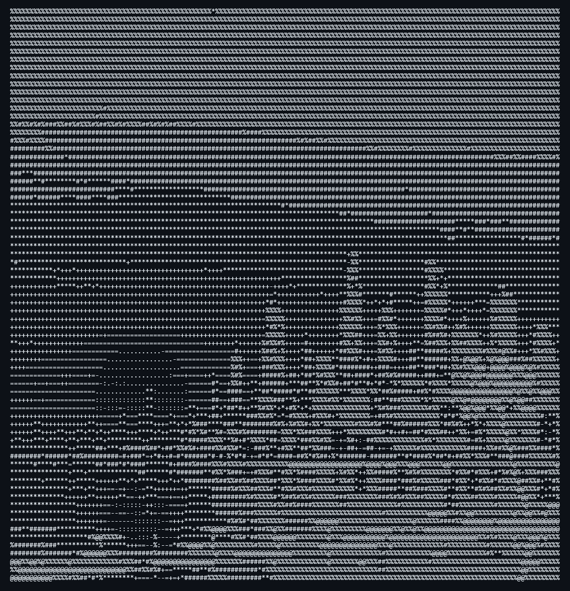

# Bombchu Benchmark

[](https://github.com/Bubbagum88/Bombchu-Benchmark/actions/workflows/build.yml)
[](LICENSE)

<p align="center"></p>

**Bombchu Benchmark** is an early-stage system-level performance profiling tool for the Nintendo GameCube and Wii homebrew ecosystem, built with devkitPro and libogc2.

The goal is to provide standardized benchmarks for storage, network, CPU, and filesystem performance to help homebrew developers optimize their projects.

---

## Current Status

Early development. What works today:

- Builds for both Wii and GameCube, against libogc2
- A text-console main menu with a benchmark selector, results screen and theme selector
- A storage benchmark (SD card write and read throughput)

> **Results are not reliable yet.** The storage benchmark divides one 8 MB file by the combined write and read time, times its own progress drawing, and may read back from cache. Treat its MB/s figure as a rough indication, not a number to compare between consoles or SD cards.

## Planned Features (subject to change)

- Storage benchmarking for USB, and more accurate SD numbers
- Network benchmarking
- CPU benchmarking (PowerPC-focused)
- Filesystem benchmarking
- GX-based UI engine and themes
- On-device visualization of benchmark results

---

## Download

Builds of tagged versions are on the [Releases page](https://github.com/Bubbagum88/Bombchu-Benchmark/releases):

- `bombchu-benchmark-wii.zip`, ready to unzip onto a Wii SD card
- `bombchu-gc.dol`, for GameCube

Builds of every commit are attached to the [Actions runs](https://github.com/Bubbagum88/Bombchu-Benchmark/actions/workflows/build.yml) as artifacts (you need to be signed in to GitHub to download them).

## Running

### Requirements
- An SD card (FAT32). The storage benchmark writes an 8 MB test file, `sd:/bombchu_storage_test.bin`, and deletes it when it finishes.
- **A GameCube controller in port 1, on both Wii and GameCube.** The Wii Remote is not supported yet.

### Wii (Homebrew Channel)
1. Unzip `bombchu-benchmark-wii.zip` to the root of the SD card, so you get `sd:/apps/bombchu/boot.dol`, `meta.xml` and `icon.png`.
2. Put the card in the Wii and open the Homebrew Channel.
3. Start **Bombchu Benchmark**.

### GameCube
Load `bombchu-gc.dol` with a homebrew loader such as [Swiss](https://github.com/emukidid/swiss-gc). GameCube support is new: the storage benchmark looks for the card at `sd:/`, which may not match the device name your SD adapter (SD2SP2, SD Gecko) mounts as, so it can fail to run there.

### Dolphin
Not tested yet. If you try it, please report what happens in an issue.

### Controls

| Button | Action |
|---|---|
| D-pad Up / Down | Move the selection |
| A | Choose, or run the selected benchmark |
| B | Go back |
| Start | Quit to the loader (from the main menu) |

---

## Repository Structure

```
benchmarks/          Benchmark modules (storage_benchmark.c)
include/             Shared headers (benchmark.h, storage_benchmark.h)
src/                 Entry point and benchmark dispatcher
ui/                  Console UI: menus, selectors, results screen
ui/themes/           Theme definitions
hbc/                 Homebrew Channel meta.xml and icon.png
images/bombchu/      Bombchu ASCII art frames
images/title/        Title screen ASCII art frames
images/previews/     Rendered previews of the ASCII art
images/source/       Source artwork the ASCII art was made from
.github/workflows/   GitHub Actions build
Makefile             Build script (devkitPPC + libogc2)
```

---

## Building

### Requirements
- [devkitPro](https://devkitpro.org/) with devkitPPC
- [libogc2](https://github.com/extremscorner/libogc2) (see its README to add the package repository)

### Compile
```bash
make                 # Wii build      -> bombchu-wii.dol
make PLATFORM=gc     # GameCube build -> bombchu-gc.dol
make OGC=$DEVKITPRO/libogc   # build against stock libogc instead of libogc2
```

You don't need a local toolchain: every push and pull request is built by GitHub Actions for both platforms, the `.dol` files are attached to each run as artifacts, and the workflow can be started by hand from the Actions tab.

### Making a release
Push a tag starting with `v` (for example `git tag v0.0.1 && git push origin v0.0.1`, or create the release from GitHub's Releases page with a new tag). The workflow builds both platforms and publishes a GitHub release with the Wii zip and the GameCube `.dol` attached. Keep the version in `hbc/meta.xml` in step with the tag.

---

## Contributing

Contributions are welcome! Please see [CONTRIBUTING.md](CONTRIBUTING.md) for guidelines on submitting patches, reporting issues, and participating in development.

Found a bug, or ran it on hardware we haven't tried? [Open an issue](https://github.com/Bubbagum88/Bombchu-Benchmark/issues) with your console, how you loaded it, your SD card or adapter, and the results screen.

## License

This software is licensed under the GNU General Public License v3.0 or later. See [LICENSE](LICENSE).
